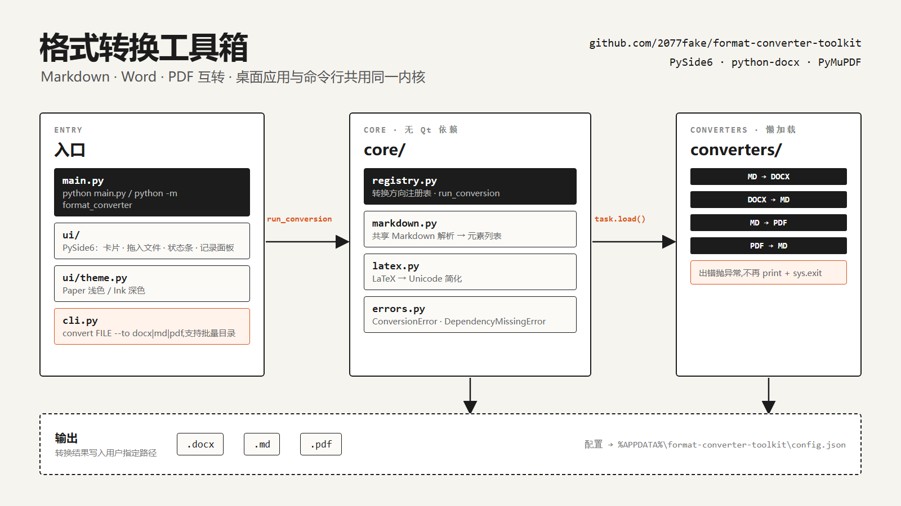

# 格式转换工具箱

Markdown · Word · PDF 互转的桌面应用，同时提供命令行。针对中文排版与 LaTeX 公式做了专门处理。

当前版本：**4.2.0**



## 快速开始

```bash
python -m venv .venv
.venv\Scripts\activate            # Windows
pip install -r requirements.txt

python main.py                    # 打开桌面应用（等价于 python -m format_converter）
```

桌面应用里选一个转换方向，点击卡片选文件，或直接把文件拖到卡片上。设置里可切换 Paper 浅色 / Ink 深色主题。

## 命令行

```bash
python -m format_converter convert a.md --to docx
python -m format_converter convert a.md --to pdf -o out/a.pdf
python -m format_converter convert report.docx --to md
python -m format_converter convert docs/ --from md --to pdf     # 批量转换整个目录
```

`pip install -e .` 之后也可以直接使用 `format-converter` 命令。

## 转换方向

| 方向 | 说明 |
|---|---|
| Markdown → Word | LaTeX 公式、表格、代码块、可点击超链接 |
| Word → Markdown | 标题层级、粗斜体、列表、表格、代码块 |
| Markdown → PDF | A4 排版，中英文混排，自动分页 |
| PDF → Markdown | 按字号识别标题，识别粗斜体与表格 |

LaTeX 支持行内 `$...$` 与块级 `$$...$$`，会被简化为可读的 Unicode 文本，例如 `$\alpha + \beta$` → `α + β`。

## 项目结构

```text
format_converter/
├── core/
│   ├── registry.py      # 转换方向注册表 + run_conversion（GUI 与 CLI 共用，无 Qt 依赖）
│   ├── markdown.py      # 共享的 Markdown 解析
│   └── latex.py         # LaTeX → Unicode 简化
├── converters/          # md_to_docx / docx_to_md / md_to_pdf / pdf_to_md，按需懒加载
├── ui/                  # PySide6 界面：theme / widgets / main_window / settings_dialog / config
├── cli.py               # 命令行入口
└── errors.py            # ConversionError、DependencyMissingError
main.py                  # 启动器
samples/                 # 示例文件
tests/                   # pytest
```

设计要点：转换器只做转换，出错抛异常而不是 `print + sys.exit`；缺少依赖（如 PyMuPDF）只影响对应方向，不影响程序启动；用户配置保存在 `%APPDATA%\format-converter-toolkit\config.json`，不再写进源码目录。

## 开发

```bash
pip install -r requirements.txt pytest
python -m pytest
```

## 版本记录

见 [CHANGELOG.md](CHANGELOG.md)。

## License

[MIT](LICENSE)
